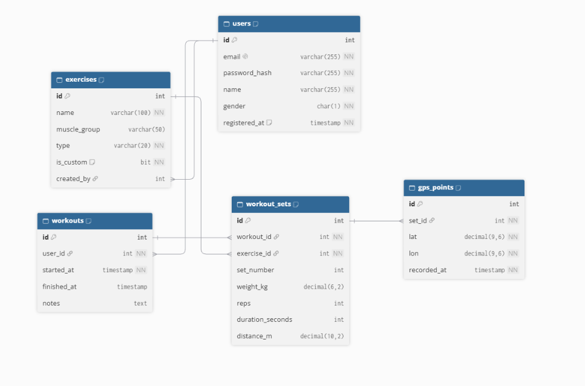

# Фитнес трегер Go

### 1. Цель работы
Целью работы является исследование предметной области, описание бизнес-процессов и функциональных требований к информационной системе, а также построение модели базы данных для веб-приложения «Фитнес-трекер».
### 2. Описание предметной области
Предметной областью является фитнес и любительский спорт, а именно — персональный мониторинг физической активности, питания и прогресса тренировок.
### 3. Основные требования к будущей информационной системе
- Регистрация, авторизация пользователей.
- Дневник тренировок: упражнения, подходы, веса, повторения, дистанция, маршрут, скорость, время.
- Формировние отчётов для отслеживание прогресса (графики веса, объёмов, силовых показателей) 
### 4. Описание бизнес-процессов
#### 4.1. Бизнес-процесс «Регистрация и авторизация пользователя»
1. Пользователь открывает сайт и выбирает команду «Регистрация».
2. Вводит почту, пароль, имя.
3. Система хеширует пароль и создаёт запись в таблице users.
4. Пользователь входит в систему.
#### 4.2. Бизнес-процесс «Запись тренировки»

1. Пользователь нажимает на кнопку «Создать тренировку».

2. В таблице workouts создается новая запись со статусом «в процессе» (поле finished_at пустое).

3. На странице тренировки пользователь выбирает дату, описание и упражнения из справочника (таблица exercises):

- Если упражнение типа strength, пользователь вносит данные по подходам (номер подхода, вес, количество повторений).

- Если упражнение типа cardio, пользователь запускает таймер, по окончании которого фиксируется общее время выполнения.

- Если упражнение типа cardio_gps, аналогично запускается таймер и происходит запись GPS-координат с устройства.

  ##### Черновик тренировки (все введенные данные) сохраняется в localStorage браузера, чтобы предотвратить потерю данных при случайном закрытии вкладки.

4. По нажатию кнопки «Сохранить/Завершить» клиент отправляет на сервер один JSON-пакет с полным описанием тренировки (упражнения, подходы, время, GPS-трек).

5. Сервер валидирует данные и в рамках одной транзакции сохраняет их в БД: тренировку в workouts, подходы/время в workout_sets, а GPS-точки в gps_points. Сервер рассчитывает и сохраняет итоговую дистанцию (distance_m).

6. Тренировка считается завершенной (обновляется finished_at) и отображается в истории профиля.
#### 4.3. Бизнес-процесс «Формирование отчётов и отслеживание прогресса»
1. Пользователь выбирает тип отчёта, период (день, неделя, месяц, пустой = вся история).
2. Выбирает измерение: вес, калории, шаги, силовые показатели, дистанция.
3. Система выполняет агрегацию данных в базе данных.
4. Формируется отчёт в виде таблицы и графика.
5. Пользователь может экспортировать отчёт в формате PDF.
### 5. Схема БД

 
